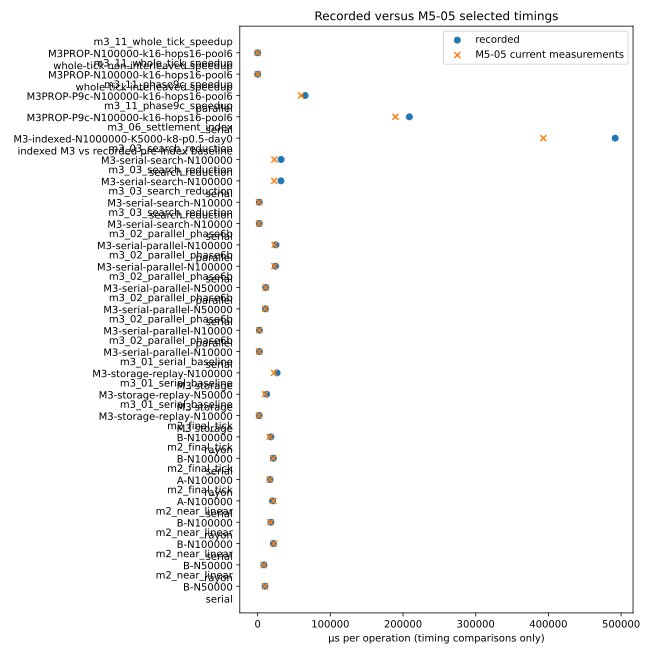

Status: sessions complete 1, 2, 3; sessions pending none

## Question

Do the selected conclusion-bearing M2/M3 timing results and mapped deterministic results still support the claims in the M0–M3 reports?

## Method

The frozen conclusion set is [`m5_05_conclusions.toml`](m5_05_conclusions.toml). Each timing stage runs its committed measurement example with A-5 sampling; every timing DVC output has a Git summary and a raw output directory. This report reads only Git summaries, not DVC raw paths. Historical values are extracted from the named reports by [m5_05.py](../../analysis/simciv_analysis/m5_05.py). Session cell data and timing are collected in the summaries under `docs/data/m5_05/`.

## Results

### Conclusion status

| milestone | conclusion                    | old values                                                                                                                                                                                                                                                                                                                                                                                    | new values                                                                                                                                                                                                                                                                                                                                                                                                                                                                 | new/old ratios                                                                                                                                                                                                                                               | derived                                         | >20% flag | status        | notes                                                                                                                                               | harness                                                                                             | measurement harness                                                                        | summary                                                             | source report                                                                                                               |
| --------- | ----------------------------- | --------------------------------------------------------------------------------------------------------------------------------------------------------------------------------------------------------------------------------------------------------------------------------------------------------------------------------------------------------------------------------------------- | -------------------------------------------------------------------------------------------------------------------------------------------------------------------------------------------------------------------------------------------------------------------------------------------------------------------------------------------------------------------------------------------------------------------------------------------------------------------------- | ------------------------------------------------------------------------------------------------------------------------------------------------------------------------------------------------------------------------------------------------------------ | ----------------------------------------------- | --------- | ------------- | --------------------------------------------------------------------------------------------------------------------------------------------------- | --------------------------------------------------------------------------------------------------- | ------------------------------------------------------------------------------------------ | ------------------------------------------------------------------- | --------------------------------------------------------------------------------------------------------------------------- |
| M2        | m2_near_linear                | B-N50000 rayon_median_us 8662.200 µs; B-N50000 serial_median_us 10081.030 µs; B-N100000 rayon_median_us 18210.730 µs; B-N100000 serial_median_us 21632.200 µs                                                                                                                                                                                                                                 | B-N50000 M2Serial 10211.687 µs/tick; M2Phase4Rayon 8202.295 µs/tick; B-N100000 M2Serial 22061.410 µs/tick; M2Phase4Rayon 17604.713 µs/tick                                                                                                                                                                                                                                                                                                                                 | B-N50000 serial 1.013×; B-N50000 rayon 0.947×; B-N100000 serial 1.020×; B-N100000 rayon 0.967×                                                                                                                                                               | 50k→100k α: serial 1.111; explicit Rayon 1.102  | false     | inconclusive  | Representative cells were remeasured; the headline covers a broader population/grid than this session.                                              | [m0_baseline_bench.rs](../../crates/sim-model/benches/m0_baseline_bench.rs)                         | [m5_05_conclusion_measure.rs](../../crates/sim-model/examples/m5_05_conclusion_measure.rs) | [summary](../data/m5_05/m2_near_linear/summary.json)                | [M2_40_FINAL_RUNTIME_PROFILE_AND_GRADUATION_GATE.md](../../docs/reports/M2_40_FINAL_RUNTIME_PROFILE_AND_GRADUATION_GATE.md) |
| M2        | m2_final_tick                 | A-N100000 rayon_median_us 16997.300 µs; A-N100000 serial_median_us 20371.400 µs; B-N100000 rayon_median_us 18210.730 µs; B-N100000 serial_median_us 21632.200 µs                                                                                                                                                                                                                              | A-N100000 M2Serial 21666.477 µs/tick; M2Phase4Rayon 16672.317 µs/tick; B-N100000 M2Serial 21304.590 µs/tick; M2Phase4Rayon 16661.217 µs/tick                                                                                                                                                                                                                                                                                                                               | A-N100000 serial 1.064×; A-N100000 rayon 0.981×; B-N100000 serial 0.985×; B-N100000 rayon 0.915×                                                                                                                                                             | —                                               | false     | does not hold | Selected 100k serial and explicit-Rayon medians compared with the recorded 17–22 ms range.                                                          | [m0_baseline_bench.rs](../../crates/sim-model/benches/m0_baseline_bench.rs)                         | [m5_05_conclusion_measure.rs](../../crates/sim-model/examples/m5_05_conclusion_measure.rs) | [summary](../data/m5_05/m2_final_tick/summary.json)                 | [M2_40_FINAL_RUNTIME_PROFILE_AND_GRADUATION_GATE.md](../../docs/reports/M2_40_FINAL_RUNTIME_PROFILE_AND_GRADUATION_GATE.md) |
| M2        | m2_phase4_crossover           | B-N1000 reported_best_rayon_us 159.930 µs; B-N1000 reported_best_serial_us 153.370 µs; B-N1000 reported_best_speedup 0.960 ×; B-N5000 reported_best_rayon_us 760.270 µs; B-N5000 reported_best_serial_us 873.330 µs; B-N5000 reported_best_speedup 1.150 ×; B-N10000 reported_best_rayon_us 1481.230 µs; B-N10000 reported_best_serial_us 1759.570 µs; B-N10000 reported_best_speedup 1.190 × | B-N1000-T6 M2Serial 166.838 µs/tick; M2Phase4Rayon 175.732 µs/tick; B-N5000-T6 M2Serial 961.954 µs/tick; M2Phase4Rayon 826.381 µs/tick; B-N10000-T1 M2Serial 1883.226 µs/tick; M2Phase4Rayon 2117.734 µs/tick                                                                                                                                                                                                                                                              | —                                                                                                                                                                                                                                                            | —                                               | false     | inconclusive  | Full-tick ratios (serial/Rayon) were 1k=0.949, 5k=1.164, 10k one-thread=0.889; combined-P4 timing was not separately measured.                      | [m0_baseline_bench.rs](../../crates/sim-model/benches/m0_baseline_bench.rs)                         | [m5_05_conclusion_measure.rs](../../crates/sim-model/examples/m5_05_conclusion_measure.rs) | [summary](../data/m5_05/m2_phase4_crossover/summary.json)           | [M2_38_DETERMINISTIC_RAYON_PHASE4_GATE.md](../../docs/reports/M2_38_DETERMINISTIC_RAYON_PHASE4_GATE.md)                     |
| M3        | m3_01_serial_baseline         | N10000-k8-p0.5 storage_median_us 2099.000 µs; N50000-k8-p0.5 storage_median_us 12464.400 µs; N100000-k8-p0.5 storage_median_us 26744.900 µs                                                                                                                                                                                                                                                   | M3-storage-replay-N10000 Storage 1827.681 µs/tick; Storage 1826.967 µs/tick; M3-storage-replay-N50000 Storage 10232.533 µs/tick; Storage 10178.590 µs/tick; M3-storage-replay-N100000 Storage 22683.518 µs/tick; Storage 22513.264 µs/tick                                                                                                                                                                                                                                 | M3-storage-replay-N10000 M3 storage 0.870×; M3-storage-replay-N50000 M3 storage 0.817×; M3-storage-replay-N100000 M3 storage 0.842×                                                                                                                          | serial storage α: 10k→50k 1.067; 50k→100k 1.145 | false     | inconclusive  | Representative cells were remeasured; the headline covers a broader population/grid than this session.                                              | [m3_01_serial_baseline_bench.rs](../../crates/sim-model/benches/m3_01_serial_baseline_bench.rs)     | [m5_05_conclusion_measure.rs](../../crates/sim-model/examples/m5_05_conclusion_measure.rs) | [summary](../data/m5_05/m3_01_serial_baseline/summary.json)         | [M3_01_SERIAL_BASELINE.md](../../docs/reports/M3_01_SERIAL_BASELINE.md)                                                     |
| M3        | m3_02_parallel_phase6b        | N10000-p0.5-pool6-chunk256 parallel_median_us 2337.400 µs; N10000-p0.5-pool6-chunk256 serial_median_us 2356.200 µs; N50000-p0.5-pool6-chunk256 parallel_median_us 11032.967 µs; N50000-p0.5-pool6-chunk256 serial_median_us 10583.533 µs; N100000-p0.5-pool6-chunk256 parallel_median_us 25183.700 µs; N100000-p0.5-pool6-chunk256 serial_median_us 24562.033 µs                              | M3-serial-parallel-N10000 Storage 1834.198 µs/tick; Parallel 2127.688 µs/tick; M3-serial-parallel-N50000 Storage 10446.350 µs/tick; Parallel 10898.623 µs/tick; M3-serial-parallel-N100000 Storage 23055.215 µs/tick; Parallel 23405.779 µs/tick                                                                                                                                                                                                                           | M3-serial-parallel-N10000 serial 0.778×; M3-serial-parallel-N10000 parallel 0.910×; M3-serial-parallel-N50000 serial 0.987×; M3-serial-parallel-N50000 parallel 0.988×; M3-serial-parallel-N100000 serial 0.939×; M3-serial-parallel-N100000 parallel 0.929× | —                                               | true      | holds         | All selected full-tick cells show no parallel gain; the historical 180-cell aggregate is not recomputed.                                            | [m3_02_parallel_phase6b_bench.rs](../../crates/sim-model/benches/m3_02_parallel_phase6b_bench.rs)   | [m5_05_conclusion_measure.rs](../../crates/sim-model/examples/m5_05_conclusion_measure.rs) | [summary](../data/m5_05/m3_02_parallel_phase6b/summary.json)        | [M3_02_PARALLEL_PHASE6B.md](../../docs/reports/M3_02_PARALLEL_PHASE6B.md)                                                   |
| M3        | m3_03_search_reduction        | N10000-p0.5 paired_saving_us 28.967 µs; N10000-p0.5 search_reduction_median_us 2187.267 µs; N10000-p0.5 serial_median_us 2190.533 µs; N100000-p0.5 paired_saving_us 622.233 µs; N100000-p0.5 search_reduction_median_us 32223.167 µs; N100000-p0.5 serial_median_us 32049.700 µs                                                                                                              | M3-serial-search-N10000 Storage 1827.543 µs/tick; SearchReduction 1828.875 µs/tick; M3-serial-search-N100000 Storage 22777.158 µs/tick; SearchReduction 23016.361 µs/tick                                                                                                                                                                                                                                                                                                  | M3-serial-search-N10000 serial 0.834×; M3-serial-search-N10000 search reduction 0.836×; M3-serial-search-N100000 serial 0.711×; M3-serial-search-N100000 search reduction 0.714×                                                                             | —                                               | true      | holds         | The selected paired savings do not exceed their paired MADs.                                                                                        | [m3_02b_search_reduction_bench.rs](../../crates/sim-model/benches/m3_02b_search_reduction_bench.rs) | [m5_05_conclusion_measure.rs](../../crates/sim-model/examples/m5_05_conclusion_measure.rs) | [summary](../data/m5_05/m3_03_search_reduction/summary.json)        | [M3_03_SEARCH_REDUCTION.md](../../docs/reports/M3_03_SEARCH_REDUCTION.md)                                                   |
| M3        | m3_06_settlement_index        | M3-indexed-N1000000-K5000-k8-p0.5-day0 indexed_before_us 491862.000 µs                                                                                                                                                                                                                                                                                                                        | M3-indexed-N1000000-K5000-k8-p0.5-day0 current indexed M3 serial storage 392992.733 µs/tick                                                                                                                                                                                                                                                                                                                                                                                | M3-indexed-N1000000-K5000-k8-p0.5-day0 indexed M3 vs recorded pre-index baseline 0.799×                                                                                                                                                                      | —                                               | true      | inconclusive  | The current indexed path was measured, but the executable pre-index implementation is absent; the recorded before value is historical context only. | [m3_scale_limit_bench.rs](../../crates/sim-model/benches/m3_scale_limit_bench.rs)                   | [m5_05_sessions23.rs](../../crates/sim-model/examples/m5_05_sessions23.rs)                 | [summary](../data/m5_05/m3_06_settlement_index/summary.json)        | [M3_06_SETTLEMENT_INDEX.md](../../docs/reports/M3_06_SETTLEMENT_INDEX.md)                                                   |
| M3        | m3_07_reversed_slots          | P4-selection-N1000000-K5000-k8-p0.5 reversed_over_normal 2.373 ×                                                                                                                                                                                                                                                                                                                              | P4-selection-N1000000-K5000-k8-p0.5 normal slots 42293.027 µs/Phase4-selection; reversed slots 99267.500 µs/Phase4-selection                                                                                                                                                                                                                                                                                                                                               | P4-selection-N1000000-K5000-k8-p0.5 reversed/normal P4 selection slowdown 0.989×                                                                                                                                                                             | —                                               | false     | holds         | The reversed/normal Phase 4 selection slowdown was 2.347×; canonical digest parity was asserted.                                                    | [m3_scale_limit_bench.rs](../../crates/sim-model/benches/m3_scale_limit_bench.rs)                   | [m5_05_sessions23.rs](../../crates/sim-model/examples/m5_05_sessions23.rs)                 | [summary](../data/m5_05/m3_07_reversed_slots/summary.json)          | [M3_07_SCALE_RESIDUAL.md](../../docs/reports/M3_07_SCALE_RESIDUAL.md)                                                       |
| M3        | m3_08_full_rebuild_equal_live | initial-N100000-live103241-k8-p0.5-day400 old_ratio 5.230 ×                                                                                                                                                                                                                                                                                                                                   | M3P-equal-live-day400-initialN100000-live103237-k8-p0.5 M3P full rebuild 121386.983 µs/tick; M3 serial storage equal-live 24785.917 µs/tick                                                                                                                                                                                                                                                                                                                                | M3P-equal-live-day400-initialN100000-live103237-k8-p0.5 M3P/M3 equal-live ratio 0.936×                                                                                                                                                                       | —                                               | false     | holds         | The equal-live ratio was 4.897× versus the recorded 5.230×; the sustained non-propagation workload was used.                                        | source unavailable: `crates/sim-model/examples/m5_05_equal_live.rs`                                 | [m5_05_sessions23.rs](../../crates/sim-model/examples/m5_05_sessions23.rs)                 | [summary](../data/m5_05/m3_08_full_rebuild_equal_live/summary.json) | [M3_08_POPULATION_DYNAMICS.md](../../docs/reports/M3_08_POPULATION_DYNAMICS.md)                                             |
| M3        | m3_09_incremental_equal_live  | initial-N100000-live103241-k8-p0.5-day400 old_ratio 1.490 ×                                                                                                                                                                                                                                                                                                                                   | M3P-equal-live-day400-initialN100000-live103237-k8-p0.5 M3P incremental topology 57601.976 µs/tick; M3 serial storage equal-live 24816.181 µs/tick                                                                                                                                                                                                                                                                                                                         | M3P-equal-live-day400-initialN100000-live103237-k8-p0.5 M3P/M3 equal-live ratio 1.558×                                                                                                                                                                       | —                                               | true      | does not hold | The equal-live ratio was 2.321× versus the recorded 1.490×; the sustained non-propagation workload was used.                                        | source unavailable: `crates/sim-model/examples/m5_05_equal_live.rs`                                 | [m5_05_sessions23.rs](../../crates/sim-model/examples/m5_05_sessions23.rs)                 | [summary](../data/m5_05/m3_09_incremental_equal_live/summary.json)  | [M3_09_INCREMENTAL_TOPOLOGY.md](../../docs/reports/M3_09_INCREMENTAL_TOPOLOGY.md)                                           |
| M3        | m3_11_phase9c_speedup         | M3PROP-P9c-N100000-k16-hops16-pool6 parallel_median_us 65283.000 µs; M3PROP-P9c-N100000-k16-hops16-pool6 serial_median_us 208693.000 µs                                                                                                                                                                                                                                                       | M3PROP-P9c-N100000-k16-hops16-pool6 M3PROP Phase9c serial 189620.729 µs/Phase9c; M3PROP Phase9c pool6/chunk256 59645.929 µs/Phase9c; max frontier 29753                                                                                                                                                                                                                                                                                                                    | M3PROP-P9c-N100000-k16-hops16-pool6 serial 0.909×; M3PROP-P9c-N100000-k16-hops16-pool6 parallel 0.914×                                                                                                                                                       | —                                               | false     | holds         | The selected Phase 9c serial/pool-6 speedup was 3.179×.                                                                                             | [m3_11_propagation_bench.rs](../../crates/sim-model/benches/m3_11_propagation_bench.rs)             | [m5_05_sessions23.rs](../../crates/sim-model/examples/m5_05_sessions23.rs)                 | [summary](../data/m5_05/m3_11_phase9c_speedup/summary.json)         | [M3_11_PROPAGATION.md](../../docs/reports/M3_11_PROPAGATION.md)                                                             |
| M3        | m3_11_whole_tick_speedup      | M3PROP-whole-tick-N100000-k16-hops16-pool6 interleaved_speedup 2.260 ×; M3PROP-whole-tick-N100000-k16-hops16-pool6 non_interleaved_speedup 2.290 ×                                                                                                                                                                                                                                            | M3PROP-N100000-k16-hops16-pool6 interleaved 159197.867/67904.556 µs/tick; non-interleaved 158759.244/67790.489 µs/tick                                                                                                                                                                                                                                                                                                                                                     | M3PROP-N100000-k16-hops16-pool6 whole-tick interleaved speedup 1.037×; M3PROP-N100000-k16-hops16-pool6 whole-tick non-interleaved speedup 1.023×                                                                                                             | —                                               | false     | holds         | Interleaved/non-interleaved speedups were 2.344×/2.342×.                                                                                            | [m3_11_propagation_bench.rs](../../crates/sim-model/benches/m3_11_propagation_bench.rs)             | [m5_05_sessions23.rs](../../crates/sim-model/examples/m5_05_sessions23.rs)                 | [summary](../data/m5_05/m3_11_whole_tick_speedup/summary.json)      | [M3_11_PROPAGATION.md](../../docs/reports/M3_11_PROPAGATION.md)                                                             |
| M3        | m3_11_frontier_crossover      | M3PROP-frontier-k8-N10000-hops8-16-transmit0.2 frontier_pool2_4 728.000 agents; M3PROP-frontier-k8-N10000-hops8-16-transmit0.2 frontier_pool6 852.000 agents                                                                                                                                                                                                                                  | M3PROP-N10000-k8-hops8-pool2-transmit0.2 M3PROP Phase9c serial 2905.611 µs/Phase9c; M3PROP Phase9c pool2/chunk256 2815.974 µs/Phase9c; max frontier 728; M3PROP-N10000-k8-hops8-pool4-transmit0.2 M3PROP Phase9c serial 2900.207 µs/Phase9c; M3PROP Phase9c pool4/chunk256 2791.221 µs/Phase9c; max frontier 728; M3PROP-N10000-k8-hops16-pool6-transmit0.2 M3PROP Phase9c serial 5944.990 µs/Phase9c; M3PROP Phase9c pool6/chunk256 4623.150 µs/Phase9c; max frontier 852 | —                                                                                                                                                                                                                                                            | —                                               | false     | holds         | Pool 2/4 at frontier 728 and pool 6 at frontier 852 were checked against the paired MAD sum and the recorded frontier size.                         | [m3_11_propagation_bench.rs](../../crates/sim-model/benches/m3_11_propagation_bench.rs)             | [m5_05_sessions23.rs](../../crates/sim-model/examples/m5_05_sessions23.rs)                 | [summary](../data/m5_05/m3_11_frontier_crossover/summary.json)      | [M3_11_PROPAGATION.md](../../docs/reports/M3_11_PROPAGATION.md)                                                             |

### Planned conclusion set

| conclusion                    | session | estimate_minutes | status   |
| ----------------------------- | ------- | ---------------- | -------- |
| m2_near_linear                | 1       | 20               | recorded |
| m2_final_tick                 | 1       | 20               | recorded |
| m2_phase4_crossover           | 1       | 30               | recorded |
| m3_01_serial_baseline         | 1       | 25               | recorded |
| m3_02_parallel_phase6b        | 1       | 45               | recorded |
| m3_03_search_reduction        | 1       | 25               | recorded |
| m3_06_settlement_index        | 2       | 50               | recorded |
| m3_07_reversed_slots          | 2       | 35               | recorded |
| m3_08_full_rebuild_equal_live | 2       | 40               | recorded |
| m3_09_incremental_equal_live  | 2       | 40               | recorded |
| m3_11_phase9c_speedup         | 3       | 45               | recorded |
| m3_11_whole_tick_speedup      | 3       | 40               | recorded |
| m3_11_frontier_crossover      | 3       | 35               | recorded |

### Selected cells

| conclusion                    | cell                                                    | N         | K     | k  | p_local | config overrides                                                                                                                              | threads | max hops | time unit           | max frontier | levels | left median    | left MAD   | right median   | right MAD    | speedup  | paired delta   | paired delta MAD | r     | minimum sample s |
| ----------------------------- | ------------------------------------------------------- | --------- | ----- | -- | ------- | --------------------------------------------------------------------------------------------------------------------------------------------- | ------- | -------- | ------------------- | ------------ | ------ | -------------- | ---------- | -------------- | ------------ | -------- | -------------- | ---------------- | ----- | ---------------- |
| m2_near_linear                | B-N50000                                                | 50,000    | 250   |    |         | world.initial_population=N; world.settlement_count=K; environment.carrying_capacity=1000*N; world.initial_settlement_resource=200*N           |         |          | us/tick             |              |        | 10,211.686667  | 69.141667  | 8,202.295      | 65.155       | 1.244979 | 1,990.955      | 74.97            | 20    | 1.083478         |
| m2_near_linear                | B-N100000                                               | 100,000   | 500   |    |         | world.initial_population=N; world.settlement_count=K; environment.carrying_capacity=1000*N; world.initial_settlement_resource=200*N           |         |          | us/tick             |              |        | 22,061.41      | 87.906667  | 17,604.713333  | 145.88       | 1.253154 | 4,415.056667   | 171.78           | 10    | 1.173299         |
| m2_final_tick                 | A-N100000                                               | 100,000   | 2     |    |         | world.initial_population=100000; world.settlement_count=K; environment.carrying_capacity=1000*N; world.initial_settlement_resource=200*N      |         |          | us/tick             |              |        | 21,666.476667  | 206.556667 | 16,672.316667  | 205.943333   | 1.299548 | 4,952.926667   | 158.513333       | 10    | 1.118902         |
| m2_final_tick                 | B-N100000                                               | 100,000   | 500   |    |         | world.initial_population=100000; world.settlement_count=K; environment.carrying_capacity=1000*N; world.initial_settlement_resource=200*N      |         |          | us/tick             |              |        | 21,304.59      | 106.263333 | 16,661.216667  | 101.866667   | 1.278694 | 4,649.01       | 128.526667       | 10    | 1.128116         |
| m2_phase4_crossover           | B-N1000-T6                                              | 1,000     | 5     |    |         | world.initial_population=N; world.settlement_count=ceil(N/200); environment.carrying_capacity=1000*N; world.initial_settlement_resource=200*N |         |          | us/tick             |              |        | 166.837654     | 0.328002   | 175.732435     | 0.680527     | 0.949385 | -8.817593      | 0.606257         | 1,188 | 1.206202         |
| m2_phase4_crossover           | B-N5000-T6                                              | 5,000     | 25    |    |         | world.initial_population=N; world.settlement_count=ceil(N/200); environment.carrying_capacity=1000*N; world.initial_settlement_resource=200*N |         |          | us/tick             |              |        | 961.953998     | 11.380689  | 826.380689     | 4.32583      | 1.164057 | 137.709471     | 10.512177        | 271   | 1.421949         |
| m2_phase4_crossover           | B-N10000-T1                                             | 10,000    | 50    |    |         | world.initial_population=N; world.settlement_count=ceil(N/200); environment.carrying_capacity=1000*N; world.initial_settlement_resource=200*N |         |          | us/tick             |              |        | 1,883.2264     | 3.898933   | 2,117.734133   | 10.438933    | 0.889265 | -232.008533    | 9.496            | 125   | 1.473204         |
| m3_01_serial_baseline         | M3-storage-replay-N10000                                | 10,000    | 50    | 8  | 0.5     | —                                                                                                                                             |         |          | us/tick             |              |        | 1,827.681111   | 6.019444   | 1,826.967222   | 4.336944     | 1.000391 | -0.2675        | 5.257778         | 120   | 1.308865         |
| m3_01_serial_baseline         | M3-storage-replay-N50000                                | 50,000    | 250   | 8  | 0.5     | —                                                                                                                                             |         |          | us/tick             |              |        | 10,232.533333  | 85.825     | 10,178.590278  | 68.522222    | 1.0053   | 36.634722      | 53.679167        | 24    | 1.449536         |
| m3_01_serial_baseline         | M3-storage-replay-N100000                               | 100,000   | 500   | 8  | 0.5     | —                                                                                                                                             |         |          | us/tick             |              |        | 22,683.518182  | 134.866667 | 22,513.263636  | 196.742424   | 1.007562 | 212.015152     | 169.251515       | 11    | 1.474312         |
| m3_02_parallel_phase6b        | M3-serial-parallel-N10000                               | 10,000    | 50    | 8  | 0.5     | —                                                                                                                                             |         |          | us/tick             |              |        | 1,834.197576   | 4.398182   | 2,127.688485   | 13.075152    | 0.862061 | -294.623939    | 11.391818        | 110   | 1.296084         |
| m3_02_parallel_phase6b        | M3-serial-parallel-N50000                               | 50,000    | 250   | 8  | 0.5     | —                                                                                                                                             |         |          | us/tick             |              |        | 10,446.35      | 71.921212  | 10,898.622727  | 85.374242    | 0.958502 | -417.756061    | 92.366667        | 22    | 1.382715         |
| m3_02_parallel_phase6b        | M3-serial-parallel-N100000                              | 100,000   | 500   | 8  | 0.5     | —                                                                                                                                             |         |          | us/tick             |              |        | 23,055.215152  | 146.315152 | 23,405.778788  | 177.163636   | 0.985022 | -299.372727    | 218.636364       | 11    | 1.516092         |
| m3_03_search_reduction        | M3-serial-search-N10000                                 | 10,000    | 50    | 8  | 0.5     | —                                                                                                                                             |         |          | us/tick             |              |        | 1,827.543333   | 4.736389   | 1,828.875      | 8.990833     | 0.999272 | 0.589722       | 10.017222        | 120   | 1.306926         |
| m3_03_search_reduction        | M3-serial-search-N100000                                | 100,000   | 500   | 8  | 0.5     | —                                                                                                                                             |         |          | us/tick             |              |        | 22,777.157576  | 247.242424 | 23,016.360606  | 239.754545   | 0.989607 | -195.881818    | 237.554545       | 11    | 1.484671         |
| m3_06_settlement_index        | M3-indexed-N1000000-K5000-k8-p0.5-day0                  | 1,000,000 | 5,000 | 8  | 0.5     | —                                                                                                                                             |         |          | us/tick             |              |        |                |            | 392,992.733333 | 3,614.966667 |          |                |                  |       |                  |
| m3_07_reversed_slots          | P4-selection-N1000000-K5000-k8-p0.5                     | 1,000,000 | 5,000 | 8  | 0.5     | —                                                                                                                                             |         |          | us/Phase4-selection |              |        | 42,293.027273  | 45.572727  | 99,267.5       | 582.590909   | 0.426051 | -56,938.818182 | 591.081818       | 11    |                  |
| m3_08_full_rebuild_equal_live | M3P-equal-live-day400-initialN100000-live103237-k8-p0.5 | 100,000   | 500   | 8  | 0.5     | propagation disabled to match the M3-08/09 non-propagation equal-live workload                                                                |         |          | us/tick             |              |        | 121,386.983333 | 166.475    | 24,785.916667  | 99.983333    | 4.897418 | 96,572.666667  | 220.225          | 4     |                  |
| m3_09_incremental_equal_live  | M3P-equal-live-day400-initialN100000-live103237-k8-p0.5 | 100,000   | 500   | 8  | 0.5     | propagation disabled to match the M3-08/09 non-propagation equal-live workload                                                                |         |          | us/tick             |              |        | 57,601.97619   | 196.266667 | 24,816.180952  | 76.67619     | 2.321146 | 32,714.847619  | 232.695238       | 7     |                  |
| m3_11_phase9c_speedup         | M3PROP-P9c-N100000-k16-hops16-pool6                     | 100,000   | 500   | 16 | 0.5     | —                                                                                                                                             | 6       | 16       | us/Phase9c          | 29,753       | 12     | 189,620.728571 | 288.485714 | 59,645.928571  | 377.928571   | 3.179106 | 130,106.057143 | 457.271429       | 7     |                  |
| m3_11_whole_tick_speedup      | M3PROP-N100000-k16-hops16-pool6                         | 100,000   | 500   | 16 | 0.5     | —                                                                                                                                             | 6       | 16       | us/tick             |              |        | 159,197.866667 | 325.733333 | 67,904.555556  | 501.155556   | 2.344436 |                |                  |       |                  |
| m3_11_frontier_crossover      | M3PROP-N10000-k8-hops8-pool2-transmit0.2                | 10,000    | 50    | 8  | 0.5     | —                                                                                                                                             | 2       | 8        | us/Phase9c          | 728          | 8      | 2,905.61124    | 13.983721  | 2,815.974419   | 6.567829     | 1.031832 | 88.399225      | 13.162791        | 258   |                  |
| m3_11_frontier_crossover      | M3PROP-N10000-k8-hops8-pool4-transmit0.2                | 10,000    | 50    | 8  | 0.5     | —                                                                                                                                             | 4       | 8        | us/Phase9c          | 728          | 8      | 2,900.207407   | 7.766296   | 2,791.221481   | 18.962222    | 1.039046 | 101.083704     | 21.377778        | 270   |                  |
| m3_11_frontier_crossover      | M3PROP-N10000-k8-hops16-pool6-transmit0.2               | 10,000    | 50    | 8  | 0.5     | —                                                                                                                                             | 6       | 16       | us/Phase9c          | 852          | 16     | 5,944.989855   | 8.661594   | 4,623.15       | 29.808696    | 1.285918 | 1,317.431159   | 30.704348        | 138   |                  |

### Deterministic confirmations

| target                    | status | harness                                                                                   | summary                                                           |
| ------------------------- | ------ | ----------------------------------------------------------------------------------------- | ----------------------------------------------------------------- |
| determinism_oracle_tests  | pass   | [determinism_oracle_tests.rs](../../crates/sim-model/tests/determinism_oracle_tests.rs)   | [deterministic summary](../data/m5_05/deterministic/summary.json) |
| m3_parallel_phase6b_tests | pass   | [m3_parallel_phase6b_tests.rs](../../crates/sim-model/tests/m3_parallel_phase6b_tests.rs) | [deterministic summary](../data/m5_05/deterministic/summary.json) |
| m3_parallel_runner_tests  | pass   | [m3_parallel_runner_tests.rs](../../crates/sim-model/tests/m3_parallel_runner_tests.rs)   | [deterministic summary](../data/m5_05/deterministic/summary.json) |
| m3_reference_runner_tests | pass   | [m3_reference_runner_tests.rs](../../crates/sim-model/tests/m3_reference_runner_tests.rs) | [deterministic summary](../data/m5_05/deterministic/summary.json) |
| m3_search_reduction_tests | pass   | [m3_search_reduction_tests.rs](../../crates/sim-model/tests/m3_search_reduction_tests.rs) | [deterministic summary](../data/m5_05/deterministic/summary.json) |
| m3_storage_runner_tests   | pass   | [m3_storage_runner_tests.rs](../../crates/sim-model/tests/m3_storage_runner_tests.rs)     | [deterministic summary](../data/m5_05/deterministic/summary.json) |
| phase4_rayon_tests        | pass   | [phase4_rayon_tests.rs](../../crates/sim-model/tests/phase4_rayon_tests.rs)               | [deterministic summary](../data/m5_05/deterministic/summary.json) |

### Timing comparison figure

### Sessions not run

All registered sessions have a recorded summary. This report does not substitute selected cells for broader historical grids or aggregate statistics.

## Findings

- [exploratory] Every listed conclusion has a generated `holds`, `does not hold`, or `inconclusive` status.
- [exploratory] Selected path ratios are flagged when the absolute deviation exceeds %; the flag does not determine the conclusion status.
- [exploratory] The deterministic test-result table records pass for every target; see [Deterministic confirmations](#deterministic-confirmations).
- [exploratory] Every pre-registered timing stage has a recorded summary.

## Limits

- Session 1 uses representative cells; M2-02 and other historical grid aggregates remain inconclusive from samples.
- Timing is specific to the recorded reference host and A-5 sampling protocol.
- No raw DVC object is needed to run `just check`; summaries are the only report inputs.

## Appendix: paired findings checks

| Finding tag | Paired predicate | Value |
|---|---|---|
| [exploratory] | `finding_all_conclusions_have_reported_status` | `true` |
| [exploratory] | `finding_ratio_flags_match_threshold` | `true` |
| [exploratory] | `finding_deterministic_targets_passed` | `true` |
| [exploratory] | `finding_all_timing_stages_recorded` | `true` |
